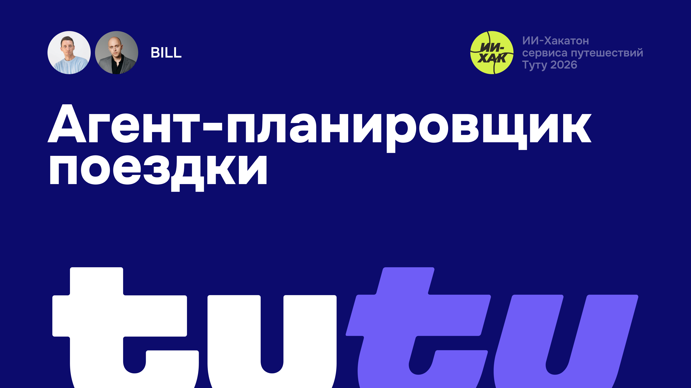

# BILL-TUTU-HACKATHON

[RU](README.md) · [EN](README.en.md) · [中文](README.zh.md) · [Español](README.es.md) · **Français**

Un produit proposé par l'équipe BILL SOFT CREATIVE, représentée par Konstantin Ivanov (Product Manager) et Rustam Baybulatov (Designer).

- Konstantin Ivanov — Product Manager, [@vonavikon](https://t.me/vonavikon)
- Rustam Baybulatov — Designer, [@baybulatovDesign](https://t.me/baybulatovDesign)

## Documents

- [product-description.md](product-description.md) — description du produit pour les décideurs.
- [product-docs/](product-docs/) — recherche et hypothèse produit :
  - [L'hypothèse de la fenêtre unique](product-docs/hypothesis-one-window.md)
  - [Économie : coûts des LLM et ce que le LLM apporte au produit](product-docs/economics.md)
  - [Fréquence d'utilisation de l'IA dans la recherche de voyages](product-docs/ai-usage-frequency.md)
